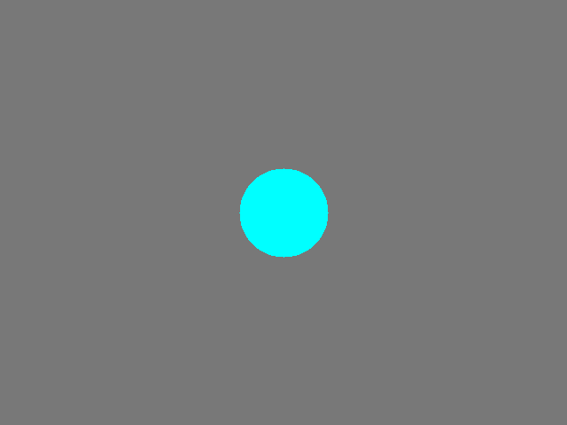

# 🎨 Air Canvas AI

[](https://www.python.org/)
[](https://opencv.org/)
[](https://developers.google.com/mediapipe)
[](LICENSE)

A touchless virtual drawing application that allows users to draw in the air using hand gestures and a webcam.

---

## 📌 Overview

**Air Canvas AI** turns your physical surroundings into an interactive digital sketchpad. Using a standard webcam, the application detects the user's hand in real time and tracks the index fingertip with high precision. The fingertip acts as a virtual paintbrush, enabling you to sketch, write, and interact with the digital canvas without ever physically touching a screen, mouse, or keyboard.

The project builds upon real-time 3D hand landmark detection using **MediaPipe Hands** and high-performance frame manipulation and graphics rendering using **OpenCV**.

---

## 🎯 Motivation

> *"What if a webcam could turn natural hand movement into a digital drawing interface?"*

Traditional digital drawing typically requires dedicated physical peripherals—graphics tablets, styluses, mice, or touchscreens. This project explores the frontiers of **touchless Human-Computer Interaction (HCI)** using modern Computer Vision. By bridging physical body language with digital visual expression, Air Canvas AI demonstrates how ubiquitous consumer hardware like a laptop webcam can serve as a responsive, intuitive, and natural user interface.

---

## ✨ Features

* **Real-time hand tracking**: Detects and tracks the user's hand on a live webcam feed at 30+ FPS.
* **21 hand landmark detection**: Locates 21 distinct 3D skeletal joint coordinates across fingers and palm.
* **Index-finger based drawing**: Smooth, anti-aliased digital drawing driven directly by the index fingertip position.
* **Gesture-based drawing controls**: Seamless, touch-free switching between drawing, color cycling, erasing, and canvas clearing.
* **Multiple brush colors**: Vibrant multi-color palette (Blue, Green, Red, Yellow) with real-time HUD color chip display.
* **Eraser mode**: Intuitive eraser with an expanded circular boundary to erase strokes with precision.
* **Canvas clearing**: Safety-confirmed open-palm clear gesture (with a circular hold progress ring) and instant clear shortcut.
* **Drawing save functionality**: Instant one-key export (`S`) that saves full-resolution composites to the `drawings/` folder with timestamped filenames.
* **Jitter reduction (EMA smoothing)**: Exponential Moving Average filtering applied to fingertip coordinates to eliminate high-frequency hand jitter.
* **Bitwise canvas blending**: Dual-layer composite rendering that keeps the webcam video feed clear and bright while keeping drawing strokes 100% opaque.
* **Real-time webcam processing**: Optimized for smooth performance with minimal latency.
* **FPS monitoring & Heads-Up Display (HUD)**: Semi-transparent HUD overlay showing active mode, selected color swatch, brush size, hand detection status, and live FPS counter.

---

## 🎥 Demo



*The index fingertip serves as the virtual pen, rendering smooth, anti-aliased strokes on the virtual canvas overlay with real-time mode feedback.*

---

## 🧠 How It Works

The processing pipeline executes frame-by-frame as follows:

```text
       Webcam
         ↓
OpenCV Frame Capture
         ↓
   MediaPipe Hands
         ↓
 21 Hand Landmarks
         ↓
Index Finger Tracking
         ↓
 Gesture Detection
         ↓
   Virtual Canvas
         ↓
   Drawing Output
```

### 1. Frame Capture & Normalization
OpenCV captures each video frame from the default webcam (`cv2.VideoCapture`). The frame is mirrored horizontally (`cv2.flip(frame, 1)`) so that user movements feel natural like looking into a mirror.

### 2. MediaPipe Hand Landmark Tracking
The mirrored frame is converted to RGB and processed by MediaPipe Hands. MediaPipe returns 21 normalized 3D landmarks \((x, y, z) \in [0.0, 1.0]\) corresponding to each joint and fingertip:

```text
       8   12  16  20        Landmark Legend:
       |   |   |   |         - 4:  Thumb Tip       - 3:  Thumb IP
   4   7  11  15  19         - 8:  Index Tip       - 6:  Index PIP
   |   |   |   |   |         - 12: Middle Tip      - 10: Middle PIP
   3   6  10  14  18         - 16: Ring Tip        - 14: Ring PIP
   |   |   |   |   |         - 20: Pinky Tip       - 18: Pinky PIP
   2---5---9--13--17         - 0:  Wrist           - 9:  Middle MCP
    \              /
     1            /
      \          /
       \        /
           0
```

### 3. Finger State Analysis & Gesture Classification
- **Fingers (Index, Middle, Ring, Pinky)**: A finger is considered extended when its tip Y-coordinate is smaller than its PIP joint (`tip.y < pip.y`), because the image origin `(0, 0)` is at the top-left corner.
- **Thumb**: Evaluated laterally based on mirrored hand classification (`Left` vs. `Right`).
- The active gesture determines the operational mode: **DRAW**, **COLOR**, **ERASER**, **CLEAR**, or **STANDBY**.

### 4. Exponential Moving Average (EMA) Smoothing
To eliminate erratic hand jitter, an exponential moving average is applied to consecutive coordinates:

$$\text{Point}_{\text{smooth}} = \alpha \cdot \text{Point}_{\text{raw}} + (1 - \alpha) \cdot \text{Point}_{\text{prev}}$$

where $\alpha = 0.55$ provides a responsive yet stable balance between latency and smoothing.

### 5. Dual-Layer Canvas Blending via Bitwise Masking
Drawings are rendered onto a dedicated black canvas array. Rather than a simple weighted blend that dims the camera, OpenCV bitwise operations are employed:
1. `cv2.cvtColor` & `cv2.threshold` create a binary mask of drawn pixels.
2. `cv2.bitwise_not` produces an inverse mask.
3. `cv2.bitwise_and` cuts out the drawing silhouette from the webcam frame and extracts vibrant foreground strokes from the canvas.
4. `cv2.add` combines the layers into a composite without fading either video or strokes.

---

## 🖐️ Gesture Controls

| Gesture | Hand Pose | Active Mode | Function |
|:---:|:---|:---:|:---|
| ☝️ | **Index finger raised only** | **DRAW** | Draw smooth, anti-aliased lines on the virtual canvas following the fingertip. |
| ✌️ | **Index + Middle fingers raised** | **COLOR** | Cycle through the palette (**Blue** ➔ **Green** ➔ **Red** ➔ **Yellow**) with debounce cooldown. |
| ✊ | **Closed fist** (all 4 fingers curled) | **ERASER** | Erase drawing strokes within a circular eraser radius centered on the knuckle. |
| 🖐️ | **Open palm** (all 4 fingers extended) | **CLEAR** | Clear the entire canvas (requires ~0.4s hold with visual circular progress ring to prevent accidents). |
| 💤 | **Other combinations / Hand lowered** | **STANDBY** | Pauses drawing without resetting the canvas state. |

---

## ⌨️ Keyboard Controls

| Key | Action | Description |
|:---:|:---|:---|
| **`Q`** / **`Esc`** | **Quit** | Exits application cleanly and releases webcam hardware. |
| **`C`** | **Clear** | Instantly resets the drawing canvas. |
| **`S`** | **Save** | Exports the current drawing composite as a PNG to the `drawings/` folder. |
| **`E`** | **Toggle Eraser** | Toggles eraser mode on/off using the index finger. |
| **`F`** | **Toggle Fullscreen** | Switches between standard window and borderless fullscreen view. |
| **`1`** | **Blue** | Selects Blue brush color. |
| **`2`** | **Green** | Selects Green brush color. |
| **`3`** | **Red** | Selects Red brush color. |
| **`4`** | **Yellow** | Selects Yellow brush color. |

---

## 🛠️ Tech Stack

* **Python 3.9+**: Core programming language.
* **OpenCV (`opencv-python`)**: Video capture, frame flipping, bitwise masking, line rasterization, and HUD rendering.
* **MediaPipe**: Real-time 21-landmark 3D hand skeletal tracking.
* **NumPy**: High-performance multi-dimensional array operations for virtual canvas buffers and image math.

---

## ⚙️ Installation

### 1. Clone the Repository

```bash
git clone https://github.com/DhananjayGharat/air-canvas-ai.git
cd air-canvas-ai
```

### 2. Create and Activate a Virtual Environment

**On Windows:**
```bash
python -m venv venv
venv\Scripts\activate
```

**On macOS / Linux:**
```bash
python3 -m venv venv
source venv/bin/activate
```

### 3. Install Dependencies

```bash
pip install -r requirements.txt
```

---

## ▶️ Usage

### Running the Application

Execute the entrypoint script:

```bash
python main.py
```

### Requirements & Tips for Best Performance
* **Webcam**: Ensure your built-in or USB webcam is connected and not locked by another program (e.g., Zoom, Teams).
* **Lighting**: Good, even lighting on your hand ensures accurate landmark detection by MediaPipe.
* **Background**: A relatively uncluttered background helps maintain tracking stability.
* **Camera Distance**: Keep your hand approximately 1.5 to 3 feet (0.5 to 1 meter) in front of the camera.

---

## 📁 Project Structure

```text
air-canvas-ai/
│
├── main.py              # Application entrypoint: tracking loop, gesture engine, canvas & HUD
├── requirements.txt     # Minimal dependencies (OpenCV, MediaPipe, NumPy)
├── README.md            # Comprehensive project documentation and guides
├── .gitignore           # Python, IDE, OS, and generated artifact exclusions
│
├── screenshots/         # Demonstration images and visuals for documentation
│   ├── demo.png
│   └── .gitkeep
│
└── drawings/            # Output folder where saved artwork (.png) is exported
    └── .gitkeep
```

---

## 🧠 What I Learned

Building this application provided deep practical experience in:

* **Real-time video processing**: Capturing, transforming, and compositing video streams frame-by-frame with low latency.
* **Hand landmark tracking**: Extracting and interpreting 21 normalized 3D anatomical landmarks from MediaPipe.
* **Gesture recognition**: Designing rule-based geometric gesture classifiers that remain robust across different hand orientations.
* **Coordinate mapping**: Converting normalized landmark values \([0, 1]\) into pixel coordinates across dynamic window dimensions.
* **Virtual canvas implementation**: Maintaining separate drawing layers and performing bitwise composition without video degradation.
* **Frame-by-frame computer vision**: Managing state transitions across frames, handling debounce timers, and detecting hand entry/exit.
* **Handling noisy/jittery hand movement**: Implementing Exponential Moving Average (EMA) filters to produce smooth, fluid lines.
* **Real-time performance considerations**: Profiling FPS, minimizing per-frame allocations, and keeping drawing operations sub-millisecond.

---

## 🔮 Future Improvements

Planned future enhancements include:

* **AI-based shape recognition**: Automatically regularizing freehand sketches into clean circles, rectangles, and triangles.
* **Handwritten text recognition**: Real-time OCR to convert written air letters into digital text.
* **Undo/redo gestures**: Gesture or shortcut support (`Ctrl+Z`) using an internal stroke history buffer.
* **More advanced gesture controls**: Two-hand gestures for pinch-to-zoom and canvas rotation.
* **Multi-hand interaction**: Using one hand as a floating color/tool palette and the other for sketching.
* **Shape-to-object conversion**: Converting drawn outlines into interactive physics-based draggable 2D objects.
* **AI-powered whiteboard capabilities**: Switching between webcam overlay and a pure digital white canvas mode with export options (PDF/SVG).

---

## 📜 Disclaimer

This project is an educational Computer Vision demonstration developed for learning, experimentation, and research in touchless Human-Computer Interaction. It is not intended as a production accessibility system, medical aid, or mission-critical interface.

---

## 👤 Author

**Gambhiram Raj**

- GitHub: [@Gambhiram-07](https://github.com/Gambhiram-07)
- Project: [Air Canvas AI](https://github.com/Gambhiram-07/air-canvas-ai)
